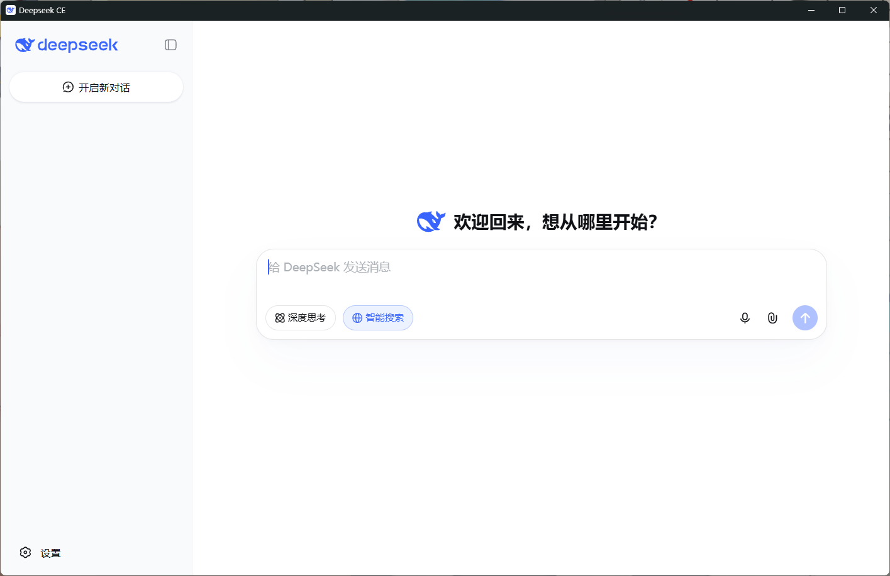

<div align="center">


# Deepseek CE

A lightweight DeepSeek chat client for Windows, Android and the web.

[](LICENSE)
[](#download)
[](#download)
[](#why-it-stays-light)

[简体中文](README.zh-CN.md) | English

</div>



Deepseek CE is a community edition rebuilt from DeepSeek's open-source [chat-demo](https://github.com/deepseek-ai/chat-demo). The interface follows the DeepSeek web app, and the client runs on Windows, Android and the browser.

It is not an official DeepSeek product. Chat, file upload and voice features call the official DeepSeek API directly with your own API key.

## Why it stays light

| Item | Size / Time |
| --- | --- |
| Windows installer | **4.7 MB** |
| Android APK | **4.8 MB** |
| Startup to first paint | **~1 s** (985 ms measured on a desktop) |
| Page render after launch | **~220 ms** |

Most chat clients ship a full Chromium runtime, which alone adds 100 MB or more. Deepseek CE does not:

- **Desktop** is built with [Tauri 2](https://v2.tauri.app/) (Rust). It renders with the WebView2 runtime that ships with Windows and stores data through native IPC instead of a local HTTP server.
- **Android** is built with [Capacitor](https://capacitorjs.com/) and renders with the system WebView.
- The frontend is React 18 compiled by rspack; the production entry is about 500 KB of JavaScript.
- The window stays hidden until the first frame is painted, so there is no white flash on launch.

The result is a small download, a short install and a launch that finishes in about a second.

## Features

- **Sessions** — create, auto-title, rename, delete, group by date, multi-select and bulk delete.
- **Editing** — edit a question or an AI reply; the edited text becomes context for later messages. Branch switching, regeneration and continuation are supported.
- **Replies** — streaming output, reasoning, web search, link reading with citations and read-aloud.
- **Attachments** — upload, paste or drag images and files; take a photo, crop it, then send; voice input with a live waveform.
- **Rendering** — Markdown, syntax highlighting, KaTeX and Mermaid.
- **Account** — sign in with an API key, view balance and available models, change the key.
- **System prompt** — default identity prompt or a custom one; an empty custom prompt omits the `system` field.
- **Settings** — Chinese / English, light / dark / follow system, TTS voice, location and model (defaults to `deepseek-flash`).
- **History** — ZIP import and export, delete all conversations.
- **Updates** — the desktop and Android builds check GitHub Releases; Android downloads the APK in place.

## Download

Grab the latest build from [Releases](https://github.com/xiaoqiezi-china/deepseek-chatapp/releases):

- **Windows**: `Deepseek-CE_x.y.z_x64-setup.exe`
- **Android**: `Deepseek-CE-x.y.z.apk`

On Windows the installer also installs the WebView2 runtime if it is missing. On Android, allow installation from unknown sources when prompted.

## Quick start

Requires Node.js 22.12+ and pnpm.

```sh
pnpm install
pnpm dev
```

`pnpm dev` starts the web app on port 8090 and its local storage service on port 8091. Open http://localhost:8090 and enter your API key in Settings → Account.

On Windows you can also double-click `start.bat` and `stop.bat`.

## Data

All data stays on your machine.

- **Web**: the local storage service writes to `data/` in the project root — `settings.json`, `summaries.json`, `sessions/<id>.json` and `files/<id>`.
- **Desktop and Android**: the same structure is written to the application data directory.

The API key is stored in plaintext in `settings.json`. Do not use the app on a shared device and never commit `data/`.

History import and export use ZIP. Exports contain conversations and local image originals; the API key and settings are never exported.

## Build

```sh
pnpm build          # static site in dist/
pnpm type           # type check
pnpm lint           # lint
```

Desktop and Android builds are described in [docs/build.md](docs/build.md).

## Layout

```text
src/                 frontend UI and logic
  services/
    api/             DeepSeek API client, SSE and protocol types
    chat/            sessions, branching, storage adapters and history
    storage/         storage backend interface
server/              local storage service for the web build
src-tauri/           Tauri 2 desktop app
android/             Capacitor Android project
docs/                build guide and screenshots
res/                 icon assets
```

## License

[MIT](LICENSE). Original work copyright DeepSeek; this project continues under the MIT license. Third-party dependencies keep their own licenses.
