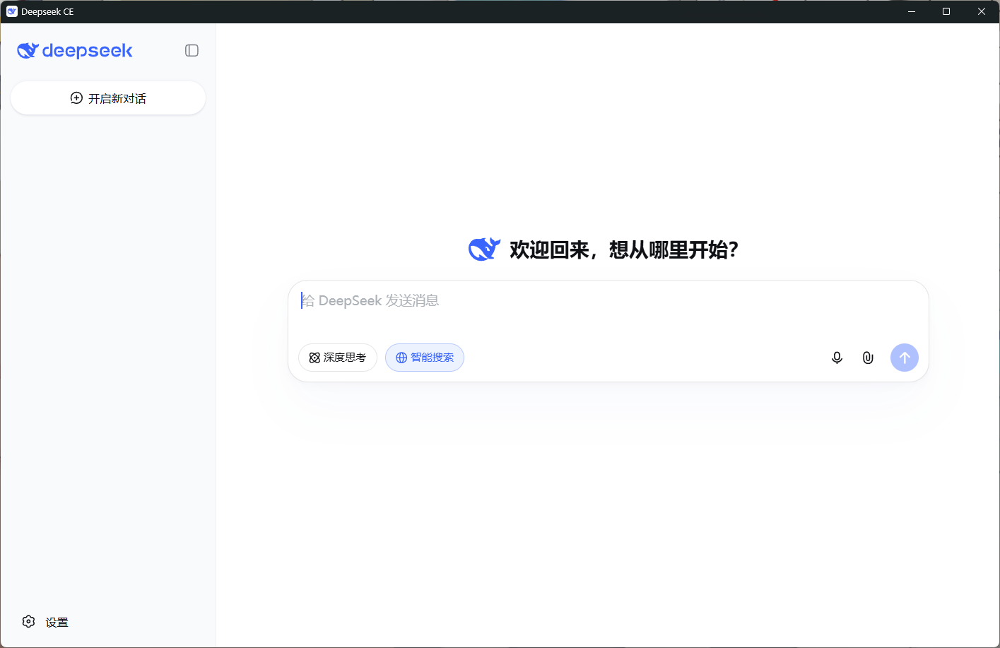

<div align="center">


# Deepseek CE

轻量的 DeepSeek 聊天客户端，支持 Windows、Android 与网页。

[](LICENSE)
[](#下载)
[](#下载)
[](#为什么这么轻)

简体中文 | [English](README.md)

</div>



Deepseek CE 是基于 DeepSeek 开源 [chat-demo](https://github.com/deepseek-ai/chat-demo) 二次开发的社区版客户端。界面参考 DeepSeek 官网，可在 Windows、Android 和浏览器中运行。

本项目不是 DeepSeek 官方产品。聊天、附件上传与语音功能使用你自己的 API Key 直接请求 DeepSeek 官方 API。

## 不仅轻量而且更快

| 项目 | 体积 / 耗时 |
| --- | --- |
| Windows 安装包 | **4.7 MB** |
| Android APK | **4.8 MB** |
| 启动到首帧 | **约 1 秒**（桌面实测 985 ms） |
| 启动后页面渲染 | **约 220 ms** |

不采用传统的浏览器内核方案，将速度与体积进一步压缩：

- **桌面端**使用 [Tauri 2](https://v2.tauri.app/)（Rust）构建，渲染采用 Windows 自带的 WebView2 运行时，数据通过原生 IPC 读写，不依赖 HTTP 服务。
- **Android 端**使用 [Capacitor](https://capacitorjs.com/) 构建，渲染交给系统 WebView。
- 前端是 React 18，由 rspack 编译，生产环境主入口约 500 KB JavaScript。
- 窗口在第一帧绘制完成后才显示，启动时没有白屏闪烁。

因此下载体积小、安装快，打开速度极快。

在实际测试中，deepseekCE的APP版本速度与deepseek官方应用持平且略快

## 功能

- **会话管理**：新建、自动标题、重命名、删除、按时间分组，支持多选与批量删除。
- **对话编辑**：可修改提问或 AI 回答，修改后的内容作为后续对话的上下文；支持消息分支切换、重新生成与继续生成。
- **回答能力**：流式输出、深度思考、智能搜索、链接阅读与来源引用、回复朗读。
- **附件**：上传、粘贴、拖拽图片和文件；拍照后可直接裁剪再发送；语音输入带实时频谱。
- **渲染**：Markdown、代码高亮、KaTeX 公式、Mermaid 图表。
- **模型**：使用 DeepSeek 官方模型，或接入任意第三方 Chat Completions 服务（自带地址、模型与密钥）。
- **代码**：在代码块中直接运行 Python / JavaScript / CMD，并预览生成的 HTML 与 SVG。
- **账号管理**：输入 API Key 登录，查看账户余额与可用模型，随时更换密钥。
- **系统提示词**：可选默认身份提示词或自定义内容；自定义留空时不发送 `system` 字段。
- **设置**：简体中文 / English、浅色 / 深色 / 跟随系统、朗读音色、位置、模型（默认 `deepseek-flash`）。
- **历史记录**：ZIP 导入导出、删除全部对话。
- **自动更新**：桌面端与 Android 端可从 GitHub Releases 检查更新，Android 支持应用内下载安装。

## 下载

从 [Releases](https://github.com/xiaoqiezi-china/deepseek-chatapp/releases) 获取最新版本：

- **Windows**：`Deepseek-CE_x.y.z_x64-setup.exe`
- **Android**：`Deepseek-CE-x.y.z.apk`

Windows 安装包会在缺少 WebView2 时自动补装；Android 首次安装需要在系统中允许"未知来源"。

## 快速开始

需要 Node.js 22.12+ 和 pnpm。

```sh
pnpm install
pnpm dev
```

`pnpm dev` 同时启动网页（8090）和本地存储服务（8091），打开 http://localhost:8090 ，在「设置 → 账号管理」中填入 API Key 即可使用。

Windows 下也可以直接双击 `start.bat` 启动、`stop.bat` 停止。

## 数据

所有数据都保存在本机。

- **网页版**：本地存储服务写入项目根目录的 `data/`，包括 `settings.json`、`summaries.json`、`sessions/<id>.json` 和 `files/<id>`。
- **桌面端与 Android**：相同结构写入各自的应用数据目录。

API Key 以明文保存在 `settings.json` 中。请不要在共享设备上使用，也不要把 `data/` 提交到仓库。

网页版存储服务默认只监听 `127.0.0.1:8091` 且没有鉴权；需要改端口或对外监听时使用 `HOST`、`PORT` 环境变量，且只应在可信网络中使用。

历史导入导出使用 ZIP 格式，导出包含会话与本地图片原件，不包含 API Key 与设置。

## 构建

```sh
pnpm build          # 静态站点输出到 dist/
pnpm type           # 类型检查
pnpm lint           # 代码检查
```

桌面端与 Android 的构建说明见 [docs/build.md](docs/build.md)。

## 项目结构

```text
src/                 前端界面与业务逻辑
  services/
    api/             DeepSeek API 请求、SSE 与协议类型
    chat/            会话、消息分支、存储适配与历史导入导出
    storage/         存储请求适配（原生 IPC / HTTP）
server/              本地存储服务（网页版）
src-tauri/           Tauri 2 桌面端
android/             Capacitor Android 工程
docs/                构建说明与截图
res/                 图标素材
```

## 协议

[MIT](LICENSE)。原项目版权归 DeepSeek，本项目在 MIT 协议下继续分发。第三方依赖遵循各自许可证。
